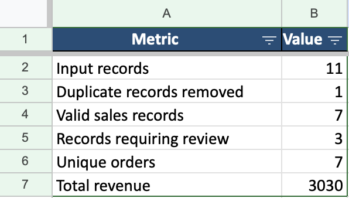

# Excel Sales Report Automation

A Python automation tool that combines multiple Excel sales files,
validates records, calculates sales performance, and generates a
formatted Excel report with charts.

## Features

- Reads and combines multiple `.xlsx` files.
- Removes exact duplicate sales records.
- Flags missing or invalid values.
- Calculates revenue by month, product, and region.
- Generates a multi-sheet Excel workbook.
- Adds charts and spreadsheet formatting.
- Includes automated unit tests.

## Requirements

- Python 3.9 or newer
- pandas
- openpyxl

## Installation

```bash
python3 -m venv .venv
source .venv/bin/activate
python -m pip install -r requirements.txt
```

## Usage

1. Put your Excel sales files in `data/input/`.
2. Run the following command to create example files if needed:

   `python create_sample_data.py`

3. Run the automation:

   `python main.py`

4. Open `output/sales_report.xlsx`.

## Run Tests

```bash
python -m unittest test_main -v
```

## Report Sheets

- Summary
- Monthly Sales
- Product Sales
- Regional Sales
- Cleaned Sales
- Invalid Records

## Data Format

Input files must contain these columns:

`order_id`, `order_date`, `product`, `category`, `region`,
`quantity`, `unit_price`

## Limitations

The program expects Excel `.xlsx` files with the required columns.
It removes exact duplicate rows and flags invalid records for review.
It does not automatically correct questionable business data.

## Technologies

Python, Pandas, OpenPyXL, unittest, Git, GitHub


## Project Output

The automation generates an Excel workbook containing sales
summaries, product performance, regional performance, cleaned
sales records, and records requiring review.

### Sales Summary

